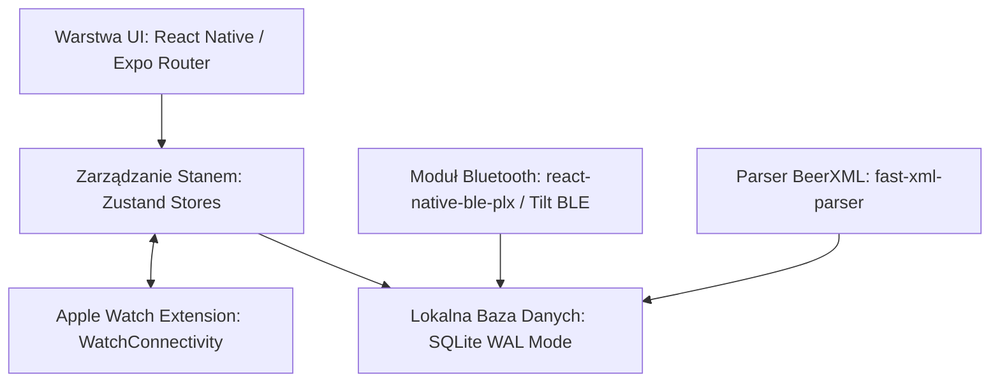

# Piwowar (Brewcraft) — Tom D2: Architektura Techniczna, Relacyjny Schemat SQLite DDL i Polityka Snapshotów

---

## 1. Architektura Systemu Offline-First

Aplikacja oparta jest na stosie **React Native / Expo** z natywnym silnikiem bazy danych **SQLite** (`expo-sqlite` w trybie WAL) oraz biblioteką reaktywnego zarządzania stanem **Zustand**.



---

## 2. Relacyjny Schemat Bazy Danych (DDL SQLite)

```sql
-- Tryb bezpiecznego zapisu transakcyjnego
PRAGMA journal_mode = WAL;
PRAGMA foreign_keys = ON;

-- 1. Style Piwne BJCP 2021 (Tabela referencyjna offline)
CREATE TABLE IF NOT EXISTS bjcp_styles (
    id TEXT PRIMARY KEY,
    category TEXT NOT NULL,
    style_code TEXT NOT NULL,
    name TEXT NOT NULL,
    og_min REAL NOT NULL,
    og_max REAL NOT NULL,
    fg_min REAL NOT NULL,
    fg_max REAL NOT NULL,
    ibu_min REAL NOT NULL,
    ibu_max REAL NOT NULL,
    srm_min REAL NOT NULL,
    srm_max REAL NOT NULL,
    abv_min REAL NOT NULL,
    abv_max REAL NOT NULL,
    description TEXT,
    aroma TEXT,
    appearance TEXT,
    flavor TEXT,
    mouthfeel TEXT,
    comments TEXT,
    history TEXT,
    commercial_examples TEXT
);

-- 2. Profile Sprzętowe Piwowara (DEC-11 Hybryda)
CREATE TABLE IF NOT EXISTS equipment_profiles (
    id TEXT PRIMARY KEY,
    name TEXT NOT NULL,
    is_default INTEGER DEFAULT 0,
    batch_volume_l REAL NOT NULL DEFAULT 20.0,
    boil_time_mins INTEGER NOT NULL DEFAULT 60,
    boil_off_l_per_hr REAL NOT NULL DEFAULT 3.0,
    mash_dead_space_l REAL NOT NULL DEFAULT 0.5,
    kettle_loss_l REAL NOT NULL DEFAULT 1.5,
    cooling_shrinkage_pct REAL NOT NULL DEFAULT 4.0,
    grain_absorption_l_per_kg REAL NOT NULL DEFAULT 0.96,
    brewhouse_efficiency_pct REAL NOT NULL DEFAULT 75.0,
    created_at TEXT NOT NULL,
    updated_at TEXT NOT NULL
);

-- 3. Receptury Bazowe
CREATE TABLE IF NOT EXISTS recipes (
    id TEXT PRIMARY KEY,
    name TEXT NOT NULL,
    bjcp_style_id TEXT REFERENCES bjcp_styles(id),
    equipment_profile_id TEXT REFERENCES equipment_profiles(id),
    target_volume_l REAL NOT NULL DEFAULT 20.0,
    target_og_sg REAL NOT NULL,
    target_fg_sg REAL NOT NULL,
    target_ibu REAL NOT NULL,
    target_srm REAL NOT NULL,
    target_abv REAL NOT NULL,
    mash_profile_json TEXT NOT NULL,
    notes TEXT,
    source TEXT DEFAULT 'manual', -- 'manual', 'beerxml', 'seed'
    created_at TEXT NOT NULL,
    updated_at TEXT NOT NULL
);

-- 4. Składniki Receptury: Słody / Surowce
CREATE TABLE IF NOT EXISTS recipe_fermentables (
    id TEXT PRIMARY KEY,
    recipe_id TEXT NOT NULL REFERENCES recipes(id) ON DELETE CASCADE,
    name TEXT NOT NULL,
    weight_kg REAL NOT NULL,
    color_lovibond REAL NOT NULL,
    potential_sg REAL NOT NULL DEFAULT 1.036,
    is_mash INTEGER DEFAULT 1,
    sort_order INTEGER DEFAULT 0
);

-- 5. Składniki Receptury: Chmiele
CREATE TABLE IF NOT EXISTS recipe_hops (
    id TEXT PRIMARY KEY,
    recipe_id TEXT NOT NULL REFERENCES recipes(id) ON DELETE CASCADE,
    name TEXT NOT NULL,
    weight_g REAL NOT NULL,
    alpha_acids_pct REAL NOT NULL,
    boil_time_mins INTEGER NOT NULL,
    use_stage TEXT NOT NULL, -- 'boil', 'dry_hop', 'whirlpool', 'first_wort'
    form TEXT DEFAULT 'pellet', -- 'pellet', 'plug', 'leaf'
    sort_order INTEGER DEFAULT 0
);

-- 6. Składniki Receptury: Drożdże
CREATE TABLE IF NOT EXISTS recipe_yeasts (
    id TEXT PRIMARY KEY,
    recipe_id TEXT NOT NULL REFERENCES recipes(id) ON DELETE CASCADE,
    name TEXT NOT NULL,
    laboratory TEXT,
    product_id TEXT,
    form TEXT DEFAULT 'dry', -- 'dry', 'liquid'
    attenuation_pct REAL NOT NULL DEFAULT 75.0,
    min_temp_c REAL NOT NULL DEFAULT 18.0,
    max_temp_c REAL NOT NULL DEFAULT 22.0
);

-- 7. Warki (Partie Produkcyjne ze Snapshotem Receptury — DEC-15=15A)
CREATE TABLE IF NOT EXISTS batches (
    id TEXT PRIMARY KEY,
    recipe_id TEXT REFERENCES recipes(id) ON DELETE SET NULL,
    batch_number INTEGER NOT NULL,
    name TEXT NOT NULL,
    brew_date TEXT NOT NULL,
    status TEXT NOT NULL, -- 'planning', 'mashing', 'boiling', 'fermenting_primary', 'fermenting_secondary', 'cold_crash', 'bottled', 'archived'
    equipment_snapshot_json TEXT NOT NULL,
    recipe_snapshot_json TEXT NOT NULL,
    measured_pre_boil_sg REAL,
    measured_pre_boil_volume_l REAL,
    measured_og_sg REAL,
    measured_fg_sg REAL,
    measured_volume_l REAL,
    calculated_abv REAL,
    calculated_efficiency_pct REAL,
    bottling_date TEXT,
    priming_sugar_type TEXT,
    priming_sugar_grams REAL,
    target_vco2 REAL,
    tasting_notes TEXT,
    bjcp_score INTEGER,
    created_at TEXT NOT NULL,
    updated_at TEXT NOT NULL
);

-- 8. Odczyty Telemetryczne Tilt BLE
CREATE TABLE IF NOT EXISTS tilt_telemetry (
    id TEXT PRIMARY KEY,
    batch_id TEXT NOT NULL REFERENCES batches(id) ON DELETE CASCADE,
    color TEXT NOT NULL, -- 'red', 'green', 'black', etc.
    raw_temp_f REAL NOT NULL,
    raw_sg REAL NOT NULL,
    calibrated_temp_c REAL NOT NULL,
    calibrated_sg REAL NOT NULL,
    calibrated_plato REAL NOT NULL,
    rssi INTEGER,
    recorded_at TEXT NOT NULL
);

-- 9. Dziennik Kolejki Zmian i Zdarzeń (Undo & Pending Ops)
CREATE TABLE IF NOT EXISTS pending_ops (
    id TEXT PRIMARY KEY,
    entity_table TEXT NOT NULL,
    entity_id TEXT NOT NULL,
    operation_type TEXT NOT NULL, -- 'INSERT', 'UPDATE', 'DELETE'
    payload_before_json TEXT,
    payload_after_json TEXT,
    created_at TEXT NOT NULL
);

-- Indeksy wydajnościowe
CREATE INDEX IF NOT EXISTS idx_batches_status ON batches(status);
CREATE INDEX IF NOT EXISTS idx_tilt_telemetry_batch ON tilt_telemetry(batch_id, recorded_at);
CREATE INDEX IF NOT EXISTS idx_recipe_fermentables ON recipe_fermentables(recipe_id);
CREATE INDEX IF NOT EXISTS idx_recipe_hops ON recipe_hops(recipe_id);
```

---

## 3. Polityka Snapshotów Warki (Zasada Nienaruszalności Historii — DEC-15)

Zgodnie z zatwierdzoną dyspozycją `DEC-15=15A`, w momencie rozpoczęcia dnia warzenia:
1. Aplikacja generuje głęboki zrzut JSON aktualnego stanu receptury oraz profilu sprzętowego (`recipe_snapshot_json`, `equipment_snapshot_json`).
2. Zrzut ten jest trwale zagnieżdżony w rekordzie tabeli `batches`.
3. Późniejsze modyfikacje receptury w bibliotece (np. zmiana chmielu czy zmiana wielkości warki) **nigdy nie wpływają na parametry historycznej warki**.
