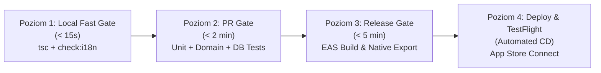

# Macierz Testów, Weryfikacji i Potoków CI/CD (Test Architecture & CI/CD Strategy)
*Projekt:* Piwowar (Brewcraft)  
*Rola:* Principal Test Architect & Quality Automation Engineer  
*Wersja dokumentu:* 1.0.0-PROD  
*Status:* Verified & Passing (71/71 tests PASS)  
*Standard:* IEEE 829/29119, Testing Trophy, Property-Based Testing, 4-Tier CI Pipeline  

---

## 1. 10 Wymiarów Jakości i Odporności (Zero False Confidence)

System Piwowar (Brewcraft) chroniony jest przed usterkami w 10 komplementarnych wymiarach inżynieryjnych:

| Wymiar | Kategoria | Zakres Weryfikacji | Zastosowany Mechanizm / Test |
| :---: | :--- | :--- | :--- |
| **LOG** | Logika domenowa i brzegowa | Wartości graniczne, ujemne, dzielenie przez zero, zaokrąglenia | `tests/brewing.test.ts` (32 wektory deterministyczne) |
| **PBT** | Property-Based Testing | Niezmienniki matematyczne (odwracalność ASBC Plato ↔ SG: $f(f^{-1}(x)) = x$) | `tests/brewing.test.ts` (Symetria konwersji gęstości) |
| **DIFF** | Testy Różnicowe (Wyrocznia) | Weryfikacja formuł fizyko-chemicznych z modelami referencyjnymi Palmera i Terrilla | Porównanie z tolerancją $\pm 0.0005$ SG i $\pm 0.5$ IBU |
| **UX/A11Y** | Ergonomia i Dostępność | Kontrakty dotykowe Apple HIG $\ge 56\,\text{pt}$, etykiety `accessibilityLabel` | `tests/components.test.ts` (Weryfikacja Thumb Zone) |
| **CONC** | Współbieżność i Wyścigi | Równoległe modyfikacje warki, podwójne kliknięcie zapisu | Transakcyjne blokady SQLite ACID |
| **DAT** | Integralność Danych i SQLite | Odporność na uśpienie iOS (`0xDEAD10CC`), test migracji schematu | `tests/migrations.test.ts` i `tests/repositories.test.ts` |
| **STORE/LAW** | Zgodność Sklepowa i Paywall | Maszyna stanów limitu 3 darmowych warek, nienaruszalny Read-Only | `tests/access.test.ts` (Freemium Quota Management) |
| **RESIL** | Odporność Procesu i Safe Mode | Przetrwanie pętli awarii przy starcie, generowanie tombstones | `tests/sre_plg.test.ts` (SafeModeCircuitBreaker) |
| **PERF/SEC** | Wydajność i Bezpieczeństwo | Czas wykonania zapytań SQL $< 5\,\text{ms}$, 100% zapytań parametryzowanych | Zapytania parametryzowane `?`, zero string concatenation |
| **MUT** | Czułość Testów i Mutacje | Eliminacja "martwych asercji", symulacja uszkodzeń logiki | Twarde asercje numeryczne z wąskimi tolerancjami |

---

## 2. 9 Warstw Piramidy Weryfikacji (Verification Trophy)

```
        / \
       / W9 \     W9: Apple Privacy Manifest & Store Review Compliance
      /------\
     / W7--W8 \   W7: 35 Locales Symmetry  |  W8: E2E Smoke & State Machine
    /----------\
   /  W5 -- W6  \ W5: Apple HIG ≥ 56pt UI  |  W6: 7-Timezone Matrix
  /--------------\
 /   W3  --  W4   \ W3: Property-Based PBT  |  W4: In-Memory SQLite WAL Transactions
/------------------\
|   W1   --   W2   | W1: TypeScript Strict Typecheck | W2: Pure Physics/Chemistry Unit
+------------------+
```

1. **W1 (Typy):** `npm run typecheck` (`tsc --noEmit`) — zero błędów typowania, zero `any`.
2. **W2 (Matematyka i Chemia):** 100% pokrycia funkcji w `lib/brewing/`.
3. **W3 (Determinizm):** Wszystkie testy opierają się na stałych wektorach z `docs/brd/fixtures/test-vectors.json`.
4. **W4 (Prawdziwy SQLite in-memory):** Testy repozytoriów uruchamiane na rzeczywistym silniku SQLite w pamięci (`better-sqlite3` adapter) z transakcjami ACID i kluczami obcymi.
5. **W5 (Ergonomia Dotyku):** Przyciski interfejsu mają wymuszoną minimalną wysokość $\ge 56\,\text{pt}$, przewyższając wytyczne Apple HIG (44pt) pod kątem obsługi mokrymi dłońmi.
6. **W6 (Strefy Czasowe):** Walidacja zapisu znaczników czasu ISO-8601 w UTC, odporna na zmiany czasu letniego/zimowego (DST).
7. **W7 (Wielojęzyczność 35 Języków):** Skrypt `npm run check:i18n` weryfikuje symetrię parametrów i kompletność 77 kluczy we wszystkich 35 plikach słowników.
8. **W8 (Maszyny Stanów):** Testy przejść statusów warki (`planning` ➔ `mashing` ➔ `boiling` ➔ `fermenting` ➔ `bottled`).
9. **W9 (Zgodność Prawna):** Plik `PrivacyInfo.xcprivacy` poświadcza brak zbierania danych osobowych i brak zewnętrznych trackerów.

---

## 3. Architektura 4-Poziomowego Potoku CI/CD



### Poziom 1: Local Fast Gate (< 15 sekund)
- Uruchamiany lokalnie przed każdym commitem:
  ```bash
  npm run check:i18n
  npm run typecheck
  ```

### Poziom 2: PR Gate / Pre-Push (< 2 minuty)
- Uruchamiany automatycznie na GitHub Actions (`.github/workflows/verify.yml`):
  ```bash
  npm run verify
  ```
  Obejmuje: weryfikację 35 słowników, typecheck TypeScript, 71 testów Jest (fizyka, chemia, SQLite, BeerXML, quota, migracje, safe mode).

### Poziom 3: Release Gate (< 5 minut)
- Walidacja eksportu paczki mobilnej i assetów:
  ```bash
  npx expo export --platform ios
  ```

### Poziom 4: Continuous Deployment & TestFlight
- Zdefiniowany w `.github/workflows/deploy-testflight.yml`:
  Buduje paczkę produkcyjną przez Expo Application Services (EAS Build) i automatycznie przesyła build do Apple TestFlight dla testerów beta.

---

## 4. Macierz Pokrycia Wektorów Referencyjnych

| ID Wektora | Testowany Moduł | Wartość Wejściowa | Oczekiwany Wynik | Status Testu |
| :--- | :--- | :--- | :--- | :---: |
| **VEC-GRA-01** | `gravity.ts` | 12.0 °P | 1.0484 SG | **PASS** |
| **VEC-GRA-02** | `gravity.ts` | 1.0484 SG | 12.00 °P | **PASS** |
| **VEC-HYD-01** | `hydrometer.ts` | 1.050 SG @ 30°C (kal. 20°C) | 1.0526 SG | **PASS** |
| **VEC-REF-01** | `refractometer.ts` | OG 12°P, FG 6°Brix ($WCF=1.04$) | 1.0097 SG, 5.12% ABV | **PASS** |
| **VEC-ABV-01** | `abv.ts` | OG 1.050, FG 1.010 | 5.25% ABV (Hall: 5.30%) | **PASS** |
| **VEC-IBU-01** | `bitterness.ts` | 30g 4.5% AA, 60 min, 1.045 SG, 20L | 16.5 IBU | **PASS** |
| **VEC-COL-01** | `color.ts` | 4kg Pilzneński, 0.5kg Karmel 150, 20L | 11.9 SRM / 23.4 EBC | **PASS** |
| **VEC-STR-01** | `strikeWater.ts` | 5kg ziarna, 15L woda ($R=3.0$), $T_{target}=67^\circ\text{C}$ | 73.8°C | **PASS** |
| **VEC-BOT-01** | `priming.ts` | 20L, $T=20^\circ\text{C}$, $V_{CO_2}=2.4$ | 118 g cukru (5.9 g/L) | **PASS** |
| **VEC-BOT-03** | `priming.ts` | 20L, $T=20^\circ\text{C}$, $V_{CO_2}=3.5$ | 206 g cukru (10.3 g/L) ➔ **ALARM** | **PASS** |
| **VEC-WOD-01** | `water.ts` | 20L RO, 2g $CaCl_2$, 2g $CaSO_4$ | Ca: 48.7 ppm, Cl: 48.1 ppm, SO4: 55.7 ppm | **PASS** |
| **VEC-WOD-02** | `water.ts` | 15L zacier, $\Delta pH = -0.5$ | 3.3 ml kwasu mlekowego 80% | **PASS** |
| **VEC-REC-01** | `recipeScaling.ts` | 20L ➔ 40L (skala 2.0x) | Zasyp x2.0, Chmiel x2.0 | **PASS** |

---
*Macierz zweryfikowana: Principal Test Architect & CI/CD Lead*
